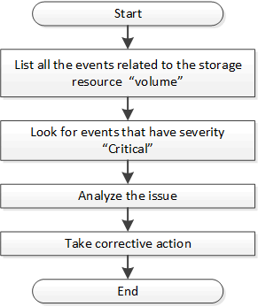

= Active IQ Unified Manager 이벤트 API를 사용하여 스토리지 오브젝트 문제를 파악합니다.
:allow-uri-read: 
:icons: font
:imagesdir: ../media/

[role="lead"]
데이터 센터의 스토리지 오브젝트가 임계값을 초과하면 해당 이벤트에 대한 알림을 받게 됩니다. 이 알림을 사용하여  `events` API를 통해 문제를 분석하고 시정 조치를 취할 수 있습니다.

이 워크플로는 볼륨을 리소스 오브젝트의 예로 사용합니다.  `events` API를 사용하여 볼륨과 관련된 이벤트 목록을 검색하고, 해당 볼륨의 주요 문제를 분석한 다음, 문제를 해결하기 위한 시정 조치를 취할 수 있습니다.

문제 해결 조치를 취하기 전에 다음 단계를 따라 볼륨의 문제를 파악하십시오.

.단계
. 데이터 센터의 볼륨에 대한 중요한 Active IQ Unified Manager 이벤트 알림을 분석합니다.
. /management-server/events API에서 다음 매개변수를 사용하여 볼륨에 대한 모든 이벤트를 쿼리합니다:
`"*resource_type": "volume*"`
`"*severity": "critical*"`
+
[cols="3*"]
|===
| 범주 | HTTP 동사 | 경로 

 a| 
management-server
 a| 
GET
 a| 
/management-server/events

|===
. 출력 결과를 확인하고 특정 볼륨의 문제점을 분석하십시오.
. Unified Manager REST API 또는 웹 UI를 사용하여 필요한 조치를 취하여 문제를 해결하십시오.

