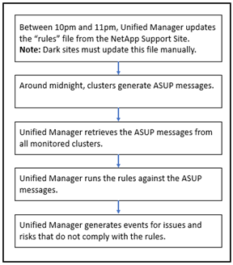

= Active IQ Unified Manager가 Active IQ 플랫폼 이벤트를 생성하는 방법
:allow-uri-read: 
:icons: font
:imagesdir: ../media/

[role="lead"]
Active IQ 플랫폼의 사고 및 위험은 다음 다이어그램에 표시된 것처럼 Unified Manager 이벤트로 변환됩니다.

보시는 바와 같이 Active IQ 플랫폼에서 컴파일된 규칙 파일은 최신 상태로 유지되고, 클러스터 AutoSupport 메시지는 매일 생성되며, Unified Manager는 이벤트 목록을 매일 업데이트합니다.
