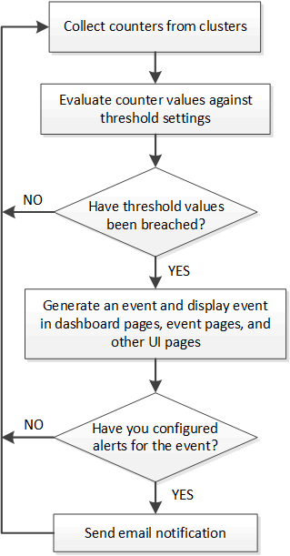

= Active IQ Unified Manager가 수신된 이벤트를 처리하는 방식 이해
:allow-uri-read: 
:icons: font
:imagesdir: ../media/

[role="lead"]
Unified Manager가 이벤트를 수신하면 해당 이벤트는 대시보드 페이지, 이벤트 관리 인벤토리 페이지, 클러스터/성능 페이지의 요약 및 탐색기 탭, 그리고 오브젝트별 인벤토리 페이지(예: 볼륨/상태 인벤토리 페이지)에 표시됩니다.

Unified Manager는 동일한 클러스터 구성 요소에 대해 동일한 이벤트 조건이 여러 번 연속적으로 발생하는 것을 감지하면, 이러한 모든 발생을 개별 이벤트가 아닌 단일 이벤트로 처리합니다. 이벤트 지속 시간은 이벤트가 여전히 활성화되어 있음을 나타내기 위해 증가합니다.

알림 설정 페이지에서 설정을 구성하는 방식에 따라 이러한 이벤트에 대해 다른 사용자에게 알림을 보낼 수 있습니다. 알림이 발생하면 다음과 같은 작업이 시작됩니다.

* 해당 이벤트에 대한 이메일을 Unified Manager 관리자 사용자 모두에게 보낼 수 있습니다.
* 해당 이벤트를 추가 이메일 수신자에게 보낼 수 있습니다.
* SNMP 트랩은 트랩 수신기로 전송될 수 있습니다.
* 사용자 지정 스크립트를 실행하여 작업을 수행할 수 있습니다.

이 워크플로는 다음 다이어그램에 나와 있습니다.

