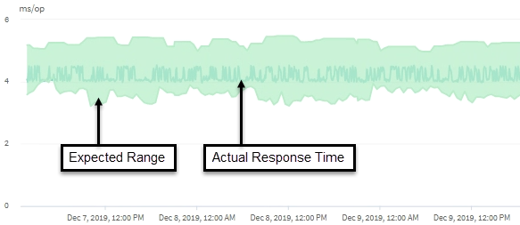

= 워크로드 지연 시간을 사용하여 Active IQ Unified Manager의 성능 문제를 파악합니다
:allow-uri-read: 
:icons: font
:imagesdir: ../media/

[role="lead"]
워크로드 지연 시간(응답 시간)은 클러스터의 볼륨이 클라이언트 애플리케이션의 I/O 요청에 응답하는 데 걸리는 시간입니다. Unified Manager는 지연 시간을 사용하여 성능 이벤트를 감지하고 알려줍니다.

지연 시간이 길다는 것은 애플리케이션에서 클러스터의 볼륨으로의 요청이 평소보다 오래 걸린다는 것을 의미합니다. 지연 시간이 길어지는 원인은 하나 이상의 클러스터 구성 요소 경합으로 인해 클러스터 자체에 있을 수 있습니다. 또한 네트워크 병목 현상, 애플리케이션을 호스팅하는 클라이언트 문제, 애플리케이션 자체 문제 등 클러스터 외부의 문제로 인해 높은 지연 시간이 발생할 수도 있습니다.

[NOTE]
====
Unified Manager는 클러스터의 워크로드 활동만 모니터링합니다. 애플리케이션, 클라이언트 또는 애플리케이션과 클러스터 간의 경로는 모니터링하지 않습니다.

====
백업 수행이나 중복 제거 실행 등 다른 워크로드에서 공유하는 클러스터 구성 요소에 대한 요구를 증가시키는 클러스터 작업도 높은 지연 시간을 유발할 수 있습니다. 실제 지연 시간이 예상 범위(지연 시간 예측)의 동적 성능 임계값을 초과하면 Unified Manager는 해당 이벤트를 분석하여 해결해야 할 성능 이벤트인지 판단합니다. 지연 시간은 작업당 밀리초(ms/op) 단위로 측정됩니다.

워크로드 분석 페이지의 전체 지연 시간 차트에서 지연 시간 통계 분석을 통해 읽기 및 쓰기 요청 등 개별 프로세스의 활동이 전체 지연 시간 통계와 어떻게 비교되는지 확인할 수 있습니다. 이 비교를 통해 어떤 작업의 활동이 가장 높은지 또는 특정 작업에서 볼륨의 지연 시간에 영향을 미치는 비정상적인 활동이 있는지 파악할 수 있습니다. 성능 이벤트를 분석할 때 지연 시간 통계를 사용하여 이벤트가 클러스터 문제로 인해 발생했는지 여부를 확인할 수 있습니다. 또한 이벤트에 관련된 특정 워크로드 활동 또는 클러스터 구성 요소를 식별할 수 있습니다.

이 예시는 지연 시간 차트를 보여줍니다. 실제 응답 시간(지연 시간) 활동은 파란색 선이고 지연 시간 예측(예상 범위)은 녹색입니다.

[NOTE]
====
Unified Manager가 데이터를 수집하지 못한 경우 파란색 선에 공백이 생길 수 있습니다. 이는 클러스터 또는 볼륨에 연결할 수 없었거나, 해당 시간 동안 Unified Manager가 꺼져 있었거나, 데이터 수집 시간이 5분보다 오래 걸렸기 때문에 발생할 수 있습니다.

====