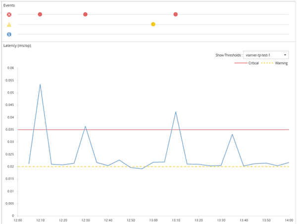

= Active IQ Unified Manager에서 사용자 정의 성능 임계값 정책 사용
:allow-uri-read: 
:icons: font
:imagesdir: ../media/

[role="lead"]
스토리지 오브젝트(예: 애그리게이트 및 볼륨)에 성능 임계값 정책을 설정하여 클러스터에 성능 문제가 발생했음을 관리자에게 알리는 이벤트를 스토리지 관리자에게 보낼 수 있습니다.

다음과 같이 스토리지 오브젝트에 대한 성능 임계값 정책을 생성합니다:

* 스토리지 오브젝트 선택
* 해당 오브젝트와 관련된 성능 카운터 선택
* 경고 및 심각한 상황으로 간주되는 성능 카운터 상한값을 정의하는 값 지정
* 카운터가 상한값을 초과해야 하는 기간 지정

예를 들어, 볼륨에 성능 임계값 정책을 설정하여 해당 볼륨의 IOPS가 10분 연속으로 초당 750 작업을 초과할 때마다 중요 이벤트 알림을 받도록 할 수 있습니다. 또한 동일한 임계값 정책을 사용하여 IOPS가 10분 동안 초당 500 작업을 초과할 때 경고 이벤트를 보내도록 지정할 수도 있습니다.

[NOTE]
====
현재 릴리스에서는 카운터 값이 설정된 임계값을 초과할 때 이벤트를 전송하는 임계값 기능을 제공합니다. 카운터 값이 설정된 임계값 미만으로 떨어질 때 이벤트를 전송하는 임계값은 설정할 수 없습니다.

====
다음은 경고 임계값(노란색 아이콘)이 1:00에 초과되었고, 심각한 임계값(빨간색 아이콘)이 12:10, 12:30, 1:10에 초과되었음을 나타내는 카운터 차트 예시입니다:

임계값 초과는 지정된 기간 동안 지속적으로 발생해야 합니다. 어떤 이유로든 임계값이 제한값 아래로 떨어지면, 이후의 초과 발생은 새로운 기간의 시작으로 간주됩니다.

일부 클러스터 오브젝트 및 성능 카운터를 사용하면 두 성능 카운터가 최대 한도를 초과해야 이벤트가 생성되는 조합 임계값 정책을 생성할 수 있습니다. 예를 들어 다음과 같은 기준을 사용하여 임계값 정책을 생성할 수 있습니다.

|===
| 클러스터 오브젝트 | 성능 카운터 | 경고 임계값 | 위험 임계값 | 기간 

 a| 
볼륨
 a| 
지연 시간
 a| 
10밀리초
 a| 
20밀리초
 a| 
15분

 a| 
애그리게이트
 a| 
사용률
 a| 
65%
 a| 
85%
 a| 

|===
두 개의 클러스터 오브젝트를 사용하는 임계값 정책은 두 조건이 모두 위반될 때만 이벤트를 생성합니다. 예를 들어, 표에 정의된 임계값 정책을 사용하는 경우:

|===
| 볼륨 지연 시간이 평균적으로... | 그리고 애그리게이트 디스크 활용률은... | 그런 다음... 

 a| 
15밀리초
 a| 
50%
 a| 
보고된 이벤트가 없습니다.

 a| 
15밀리초
 a| 
75%
 a| 
경고 이벤트가 보고되었습니다.

 a| 
25밀리초
 a| 
75%
 a| 
경고 이벤트가 보고되었습니다.

 a| 
25밀리초
 a| 
90%
 a| 
중대한 이벤트가 보고되었습니다.

|===