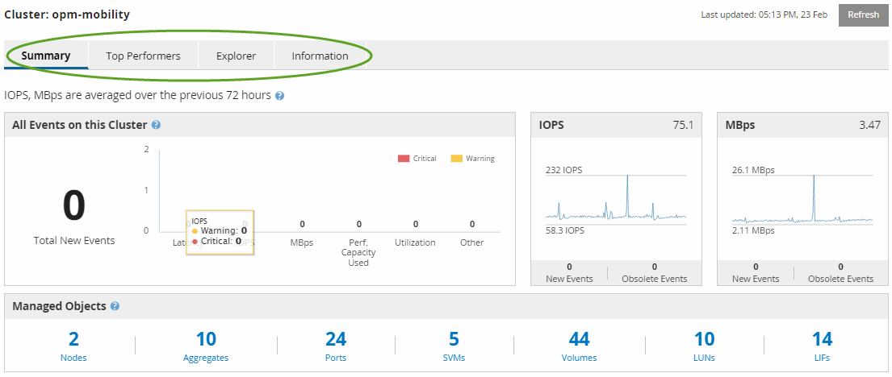

= Active IQ Unified Manager의 Performance Cluster Landing 페이지 이해
:allow-uri-read: 
:icons: font
:imagesdir: ../media/

[role="lead"]
성능 클러스터 랜딩 페이지는 선택한 클러스터의 성능 개요를 간략하게 보여주며, 특히 클러스터 내 상위 10개 오브젝트의 성능 상태를 중점적으로 표시합니다. 성능 문제는 페이지 상단의 '이 클러스터의 모든 이벤트' 패널에 표시됩니다.

성능 클러스터 랜딩 페이지는 Unified Manager 인스턴스에서 관리하는 각 클러스터에 대한 개략적인 정보를 제공합니다. 이 페이지에서는 이벤트 및 성능 정보를 확인할 수 있으며, 클러스터를 모니터링하고 문제를 해결할 수 있습니다. 다음 이미지는 opm-mobility라는 클러스터의 성능 클러스터 랜딩 페이지 예시입니다:

클러스터 요약 페이지의 이벤트 개수가 성능 이벤트 인벤토리 페이지의 이벤트 개수와 일치하지 않을 수 있습니다. 이는 클러스터 요약 페이지에서는 조합 임계값 정책이 위반되었을 때 지연 시간 및 사용률 막대에 각각 하나의 이벤트가 표시될 수 있는 반면, 성능 이벤트 인벤토리 페이지에서는 조합 정책 위반 시 하나의 이벤트만 표시되기 때문입니다.

[NOTE]
====
Unified Manager에서 관리 대상에서 제외된 클러스터의 경우 페이지 상단의 클러스터 이름 오른쪽에 *제거됨*이라는 상태가 표시됩니다.

====