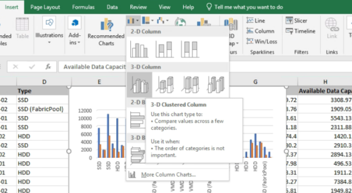

= Active IQ Unified Manager에서 총 애그리게이트 용량 대 사용 가능한 용량 차트 표시
:allow-uri-read: 
:icons: font
:imagesdir: ../media/

[role="lead"]
Excel 차트 형식으로 스토리지 총 용량 및 약정 용량을 분석하는 보고서를 생성할 수 있습니다.

.시작하기 전에
* 애플리케이션 관리자 또는 스토리지 관리자 역할이 있어야 합니다.

다음 단계를 따라 상태: 모든 애그리게이트 뷰를 열고, 뷰를 Excel로 다운로드하고, 총 용량 및 커밋된 용량 차트를 생성하고, 사용자 지정 Excel 파일을 업로드하고, 최종 보고서를 예약하십시오.

.단계
. 왼쪽 탐색 창에서 *스토리지* > *애그리게이트*를 클릭합니다.
. *보고서* > *Excel 다운로드*를 선택합니다.
+
image::../media/download_excel_menu.png[보고서에서 엑셀을 다운로드하는 방법을 보여주는 UI 스크린샷입니다.]

+
사용하는 브라우저에 따라 파일을 저장하려면 *확인*을 클릭해야 할 수도 있습니다.

. Excel에서 다운로드한 파일을 엽니다.
. 필요한 경우 *편집 활성화*를 클릭하십시오.
. 데이터 시트에서 유형 열을 마우스 오른쪽 버튼으로 클릭하고 *정렬* > *A에서 Z 순으로 정렬*을 선택합니다.
+
image::../media/sort_01.png[유형 열에서 정렬을 선택하는 방법을 보여주는 UI 스크린샷입니다.]

+
이렇게 하면 다음과 같은 스토리지 유형 등으로 데이터를 정렬합니다:

+
** HDD
** 하이브리드
** SSD
** SSD(FabricPool)

.  `Type, Total Data Capacity,` 및  `Available Data Capacity` 열을 선택하십시오.
. *삽입* 메뉴에서  `3-D column` 차트를 선택합니다.
+
차트는 데이터시트에 나와 있습니다.

+

. 차트를 마우스 오른쪽 버튼으로 클릭하고 *차트 이동*을 선택하십시오.
. *새 시트*를 선택하고 시트 이름을 *총 스토리지 차트*로 지정하십시오.
+
[NOTE]
====
새 시트가 정보 시트와 데이터 시트 다음에 나타나는지 확인하십시오.

====
. 차트 제목을 *총 용량 대비 가용 용량*으로 지정하십시오.
. 차트를 선택했을 때 나타나는 *디자인* 및 *서식* 메뉴를 사용하여 차트의 모양을 사용자 지정할 수 있습니다.
. 변경 사항에 만족하면 파일을 저장하십시오. 파일 이름이나 위치는 변경하지 마십시오.
+
image::../media/total_vs_available_capacity.png[총 용량 대비 가용 용량 차트를 보여주는 UI 스크린샷입니다.]

. Unified Manager에서 *보고서* > *Excel 업로드*를 선택합니다.
+
[NOTE]
====
Excel 파일을 다운로드한 뷰와 동일한 뷰에 있는지 확인하십시오.

====
. 수정한 Excel 파일을 선택하십시오.
. *열기*를 클릭하세요.
. *제출*을 클릭하십시오.
+
*보고서* > *Excel 업로드* 메뉴 항목 옆에 확인 표시가 나타납니다.

+
image::../media/upload_excel.png[엑셀 파일을 보고서에 업로드하는 방법을 보여주는 UI 스크린샷입니다.]

. *예약 보고서*를 클릭합니다.
. *일정 추가*를 클릭하여 *보고서 일정* 페이지에 새 행을 추가하고 새 보고서의 일정 특성을 정의하십시오.
+
[NOTE]
====
보고서에 대해 *XLSX* 형식을 선택하십시오.

====
. 보고서 일정의 이름을 입력하고 나머지 보고서 필드를 모두 작성한 다음 행 끝에 있는 확인 표시(image:../media/blue_check.gif[""])를 클릭하십시오.
+
보고서는 테스트 목적으로 즉시 전송됩니다. 이후 보고서는 생성된 후 지정된 빈도로 나열된 수신자에게 이메일로 전송됩니다.

보고서에 나타난 결과를 바탕으로, 애그리게이트의 부하 분산을 고려해야 할 수도 있습니다.
