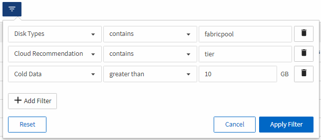
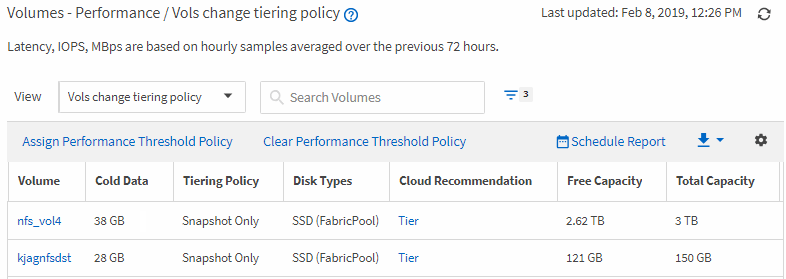

= Active IQ Unified Manager에서 클라우드 계층으로 데이터를 이동해야 하는 볼륨을 식별합니다
:allow-uri-read: 
:icons: font
:imagesdir: ../media/

[role="lead"]
현재 FabricPool 애그리게이트에 상주하고, 클라우드 권장 사항이 Tier이며, 콜드 데이터가 많은 볼륨 목록을 포함하는 보고서를 생성할 수 있습니다. 이 보고서를 통해 특정 볼륨의 티어링 정책을 "`auto`" 또는 "`all`"로 변경하여 더 많은 콜드(비활성) 데이터를 클라우드 티어로 오프로드해야 하는지 여부를 결정할 수 있습니다.

.시작하기 전에
* 애플리케이션 관리자 또는 스토리지 관리자 역할이 있어야 합니다.
* FabricPool 애그리게이트를 구성하고 해당 애그리게이트에 볼륨이 있어야 합니다.

아래 단계를 따라 필요한 열을 올바른 순서로 표시하는 사용자 지정 보기를 만든 다음, 해당 보기에 대한 보고서 생성을 예약하세요.

.단계
. 왼쪽 탐색 창에서 *스토리지* > *볼륨*을 클릭합니다.
. 보기 메뉴에서 *성능* > *모든 볼륨*을 선택합니다.
. 열 선택기에서 "`디스크 유형`" 열이 보기에 표시되는지 확인하십시오.
+
보고서에 중요한 보기를 만들려면 다른 열을 추가하거나 제거하세요.

. "`디스크 유형`" 열을 "`클라우드 권장 사항`" 열 근처로 드래그 앤 드롭합니다.
. 필터 아이콘을 클릭하고 다음 세 가지 필터를 추가한 다음 *필터 적용*을 클릭합니다:
+
** 디스크 유형에 FabricPool이 포함됨
** 클라우드 추천에는 티어가 포함되어 있습니다
** 콜드 데이터가 10GB 초과 

. 콜드 데이터가 가장 많은 볼륨이 보기 상단에 표시되도록 콜드 데이터 열의 맨 위를 클릭합니다.
. 뷰에 표시되는 내용을 반영하는 이름으로 뷰를 저장합니다(예: "`Vols change tiering policy`").
. 인벤토리 페이지에서 *예약 보고서* 버튼을 클릭하십시오.
. 새 보고서의 일정 특성을 정의할 수 있도록 *일정 추가*를 클릭하여 보고서 일정 페이지에 새 행을 추가하십시오.
. 보고서 일정의 이름을 입력하고 나머지 보고서 필드를 모두 작성한 다음 행 끝에 있는 확인 표시(image:../media/blue_check.gif[""])를 클릭하십시오.
+
보고서는 테스트 목적으로 즉시 전송됩니다. 이후 보고서는 생성된 후 지정된 빈도로 나열된 수신자에게 이메일로 전송됩니다.

보고서에 표시된 결과를 바탕으로 System Manager 또는 ONTAP CLI를 사용하여 특정 볼륨에 대한 계층화 정책을 "`auto`" 또는 "`all`"로 변경하여 더 많은 콜드 데이터를 클라우드 계층으로 오프로드하는 것이 좋습니다.
