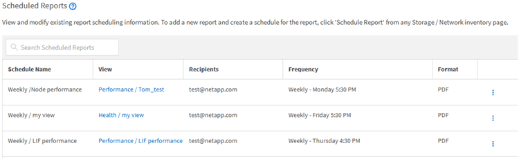

= Active IQ Unified Manager에서 예약된 보고서 삭제
:allow-uri-read: 
:icons: font
:imagesdir: ../media/

[role="lead"]
보고서가 예약된 후 보고서 예약 페이지에서 삭제할 수 있습니다.

.시작하기 전에
* 애플리케이션 관리자 또는 스토리지 관리자 역할이 있어야 합니다.

.단계
. 왼쪽 탐색 창에서 *스토리지 관리* > *보고서 일정*을 클릭합니다.
+

+
[NOTE]
====
적절한 권한이 있는 경우 시스템에서 모든 보고서와 해당 보고서의 일정을 삭제할 수 있습니다.

====
. 삭제하려는 일정의 더보기 아이콘 image:../media/more_icon.gif[""]을 클릭합니다.
. *삭제*를 클릭합니다.
. 결정을 확정하세요.
+
예정된 보고서가 목록에서 제거되었으며, 더 이상 설정된 일정에 따라 생성 및 배포되지 않습니다.

+
[NOTE]
====
인벤토리 페이지에서 사용자 지정 보기를 삭제하면 해당 보기를 사용하는 모든 사용자 지정 Excel 파일 또는 예약된 보고서도 함께 삭제됩니다.

====

