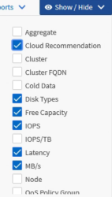
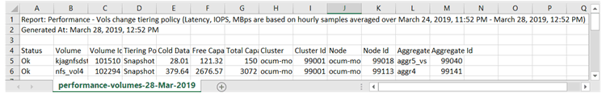

= Active IQ Unified Manager에서 보고 시작하기
:allow-uri-read: 
:icons: font
:imagesdir: ../media/

[role="lead"]
샘플 사용자 지정 보고서를 만들어 보기 탐색 및 보고서 예약 기능을 경험해 보세요. 이 빠른 시작 보고서는 비활성(콜드) 데이터가 상당량 포함되어 있어 클라우드 계층으로 이동하는 것이 좋을 수 있는 볼륨 목록을 찾습니다. 성능: 모든 볼륨 보기를 열고 필터와 열을 사용하여 보기를 사용자 지정한 다음, 사용자 지정 보기를 보고서로 저장하고 일주일에 한 번 공유하도록 보고서를 예약합니다.

.시작하기 전에
* 애플리케이션 관리자 또는 스토리지 관리자 역할이 있어야 합니다.
* FabricPool 애그리게이트를 구성하고 해당 애그리게이트에 볼륨이 있어야 합니다.

다음 단계를 따르십시오:

* 기본 보기 열기
* 데이터를 필터링하고 정렬하여 열을 사용자 지정하세요
* 뷰를 저장하십시오
* 사용자 지정 보기에 대한 보고서 생성을 예약합니다.

.단계
. 왼쪽 탐색 창에서 *스토리지* > *볼륨*을 클릭합니다.
. 보기 메뉴에서 *성능* > *모든 볼륨*을 선택합니다.
. "`디스크 유형`" 열이 보기에 표시되는지 확인하려면 *표시/숨기기*를 클릭하십시오.
+

+
보고서에 중요한 필드가 포함된 뷰를 생성하려면 다른 열을 추가하거나 제거하십시오.

. "`디스크 유형`" 열을 "`클라우드 권장 사항`" 열 옆으로 드래그하십시오.
. 필터 아이콘을 클릭하여 다음 세 가지 필터를 추가한 다음 *필터 적용*을 클릭하십시오:
+
** 디스크 유형에는 FabricPool이 포함됩니다
** 클라우드 추천에는 티어가 포함되어 있습니다
** 10GB 이상의 콜드 데이터 image:../media/filter_cold_data_2.png["필터 옵션에서 필터를 적용하는 방법을 보여주는 UI 스크린샷입니다."]

+
각 필터는 논리 AND로 연결되므로 반환되는 모든 볼륨은 모든 조건을 충족해야 합니다. 최대 5개의 필터를 추가할 수 있습니다.

. 콜드 데이터 열의 맨 위를 클릭하여 콜드 데이터가 가장 많은 볼륨이 보기 상단에 표시되도록 결과를 정렬하십시오.
. 뷰를 사용자 지정하면 뷰 이름이 Unsaved View가 됩니다. 뷰에 표시되는 내용을 반영하도록 뷰 이름을 지정하십시오(예: "`Vols change tiering policy`"). 완료되면 확인 표시를 클릭하거나 *Enter*를 눌러 새 이름으로 뷰를 저장하십시오.
+
image::../media/report_vol_code_data_2.png[필요한 열이 올바른 순서로 표시된 Vols 계층화 정책 변경 페이지를 보여주는 UI 스크린샷입니다.]

. 보고서를 *CSV*, *Excel* 또는 *PDF* 파일로 다운로드하여 예약하거나 공유하기 전에 결과를 확인하세요.
+
Microsoft Excel(CSV 또는 Excel)이나 Adobe Acrobat(PDF) 등 설치된 응용 프로그램으로 파일을 열거나 파일을 저장하십시오.

+
[NOTE]
====
보기를 Excel 파일로 다운로드하여 복잡한 필터, 정렬, 피벗 테이블 또는 차트를 사용하여 보고서를 추가로 사용자 지정할 수 있습니다. Excel에서 파일을 연 후 고급 기능을 사용하여 보고서를 사용자 지정하십시오. 만족스러우면 Excel 파일을 업로드하십시오. 사용자 지정 내용이 포함된 이 파일은 보고서가 실행될 때 보기에 적용됩니다.

====
+
Excel을 사용하여 보고서를 사용자 지정하는 방법에 대한 자세한 내용은 _Microsoft Excel 보고서 샘플_을 참조하십시오.

. 인벤토리 페이지에서 *예약 보고서* 버튼을 클릭합니다. 오브젝트(이 경우 볼륨)와 관련된 모든 예약 보고서가 목록에 표시됩니다.
+
image::../media/scheduled_reports_3.gif[오브젝트와 관련된 예약된 모든 보고서를 보여주는 UI 스크린샷.]

. 새 보고서의 일정 특성을 정의할 수 있도록 *일정 추가*를 클릭하여 보고서 일정 페이지에 새 행을 추가하십시오.
. 보고서 이름을 입력하고 나머지 보고서 필드를 모두 작성한 다음 행 끝에 있는 확인 표시(image:../media/blue_check.gif[""])를 클릭하십시오.
+
보고서는 테스트 목적으로 즉시 전송됩니다. 이후 보고서는 생성된 후 지정된 빈도로 나열된 수신자에게 이메일로 전송됩니다.

+
다음 샘플 보고서는 CSV 형식입니다:

+

+
다음 샘플 보고서는 PDF 형식입니다:

+
image::../media/pdf_sample_report.gif[PDF 형식의 샘플 보고서를 보여주는 UI 스크린샷입니다.]

보고서에 표시된 결과를 바탕으로, 더 많은 콜드 데이터를 클라우드 계층으로 오프로드하기 위해 특정 볼륨의 계층화 정책을 "`auto`" 또는 "`all`"로 변경하려면 ONTAP System Manager 또는 ONTAP CLI를 사용하는 것이 좋습니다.
