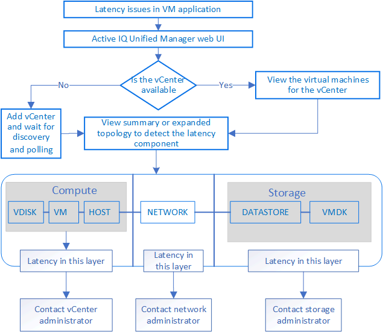

= Active IQ Unified Manager가 VMware 가상 인프라를 모니터링하는 방법 이해
:allow-uri-read: 
:icons: font
:imagesdir: ../media/

[role="lead"]
Active IQ Unified Manager는 가상 인프라의 가상 머신(VM)에 대한 가시성을 제공하며, 가상 환경의 스토리지 및 성능 문제를 모니터링하고 해결할 수 있도록 지원합니다. 이 기능을 사용하여 스토리지 환경의 지연 시간 문제를 파악하거나 vCenter Server에서 성능 이벤트가 보고될 때 이를 확인할 수 있습니다.

ONTAP의 일반적인 가상 인프라 구축에는 컴퓨팅, 네트워크 및 스토리지 계층에 걸쳐 분산된 다양한 구성 요소가 있습니다. VM 애플리케이션의 성능 저하는 각 계층의 다양한 구성 요소에서 발생하는 지연 시간이 복합적으로 작용하여 발생할 수 있습니다. 이 기능은 가상 환경에서 성능 문제를 분석하고 어느 구성 요소에서 문제가 발생했는지 파악해야 하는 스토리지 및 vCenter Server 관리자와 IT 담당자에게 유용합니다.

이제 VMware 섹션의 vCenter 메뉴에서 vCenter Server에 액세스할 수 있습니다. 나열된 각 가상 머신의 미리 보기에는 새 브라우저에서 vCenter Server를 실행하는 TOPOLOGY VIEW의 *VCENTER SERVER* 링크가 있습니다. 또한 *Expand Topology* 버튼을 사용하여 vCenter Server를 실행하고 *View in vCenter* 버튼을 클릭하여 vCenter Server에서 데이터스토어를 볼 수도 있습니다.

Unified Manager는 컴퓨팅 노드, 네트워크 또는 스토리지에서 지연 문제가 발생했는지 파악할 수 있도록 가상 환경의 기본 하위 시스템을 토폴로지 보기로 제공합니다. 또한 이 보기에서는 성능 저하를 유발하는 특정 오브젝트를 강조 표시하여 조치를 취하고 근본적인 문제를 해결할 수 있도록 합니다.

ONTAP 스토리지에 배포된 가상 인프라에는 다음과 같은 오브젝트가 포함됩니다.

* vCenter Server: 가상 환경에서 VMware VM, ESXi 호스트 및 모든 관련 구성 요소를 관리하기 위한 중앙 집중식 컨트롤 플레인입니다. vCenter Server에 대한 자세한 내용은 VMware 설명서를 참조하십시오.
* 호스트: VMware의 가상화 소프트웨어인 ESXi를 실행하고 VM을 호스팅하는 물리적 또는 가상 시스템.
* 데이터스토어: 데이터스토어는 ESXi 호스트에 연결된 가상 스토리지 오브젝트입니다. 데이터스토어는 LUN 또는 볼륨 등 ONTAP의 관리 가능한 스토리지 엔티티로, 로그 파일, 스크립트, 구성 파일 및 가상 디스크 등 VM 파일을 위한 저장소로 사용됩니다. 이들은 SAN 또는 IP 네트워크 연결을 통해 환경의 호스트에 연결됩니다. vCenter Server에 매핑된 ONTAP 외부의 데이터스토어는 Unified Manager에서 지원되거나 표시되지 않습니다.
* VM: VMware 가상 머신.
* 가상 디스크: VM에 속한 데이터스토어에 있는 가상 디스크로, 확장자가 VMDK입니다. 가상 디스크의 데이터는 해당 VMDK에 저장됩니다.
* VMDK: 가상 디스크에 스토리지 공간을 제공하는 데이터스토어의 가상 머신 디스크입니다. 각 가상 디스크마다 해당하는 VMDK가 있습니다.

이러한 오브젝트는 VM 토폴로지 뷰에 표시됩니다.

*ONTAP 기반 VMware 가상화*

image::../media/vm_deployment.gif[VMware 호스트, VM, 데이터스토어, VMDK, IP 네트워크 및 스토리지 연결을 보여주는 다이어그램]

*사용자 워크플로*

다음 다이어그램은 VM 토폴로지 보기를 사용하는 일반적인 사용 사례를 보여줍니다:

[[what-is-not-supported]]
== 지원되지 않는 기능

* ONTAP 외부에 있고 vCenter Server 인스턴스에 매핑된 데이터스토어는 Unified Manager에서 지원되지 않습니다. 해당 데이터스토어에 가상 디스크가 있는 VM도 지원되지 않습니다.
* 여러 LUN에 걸쳐 있는 데이터스토어는 지원되지 않습니다.
* 데이터 LIF(액세스 엔드포인트) 매핑에 NAT(네트워크 주소 변환)를 사용하는 데이터 저장소는 지원되지 않습니다.
* Unified Manager는 어떤 데이터스토어가 어떤 클러스터에 속하는지 식별할 수 없으므로, 다중 LIF 구성에서 동일한 IP 주소를 가진 다른 클러스터에 볼륨 또는 LUN을 데이터스토어로 내보내는 것은 지원되지 않습니다.
+
예시: 클러스터 A에 데이터스토어 A가 있다고 가정해 보겠습니다. 데이터스토어 A는 동일한 IP 주소 x.x.x.x를 사용하여 데이터 LIF를 통해 내보내지고 VM A가 이 데이터스토어에 생성됩니다. 마찬가지로 클러스터 B에는 데이터스토어 B가 있습니다. 데이터스토어 B는 동일한 IP 주소 x.x.x.x를 사용하여 데이터 LIF를 통해 내보내지고 VM B가 데이터스토어 B에 생성됩니다. UM은 VM A의 토폴로지에 대한 데이터스토어 A를 해당 ONTAP 볼륨/LUN에 매핑할 수 없으며 VM B도 매핑할 수 없습니다.

* 데이터스토어로는 NAS 및 SAN 볼륨(VMFS의 경우 iSCSI 및 FCP)만 지원되며, 가상 볼륨(vVols)은 지원되지 않습니다.
* iSCSI 가상 디스크만 지원됩니다. NVMe 및 SATA 유형의 가상 디스크는 지원되지 않습니다.
* 이 보기에서는 다양한 구성 요소의 성능을 분석하기 위한 보고서를 생성할 수 없습니다.
* Unified Manager의 가상 인프라에 대해서만 지원되는 스토리지 가상 머신(스토리지 VM) 재해 복구(DR) 설정의 경우, 스위치오버 및 스위치백 시나리오에서 활성 LUN을 가리키도록 vCenter Server에서 구성을 수동으로 변경해야 합니다. 수동 개입이 없으면 해당 데이터스토어에 접근할 수 없게 됩니다.

